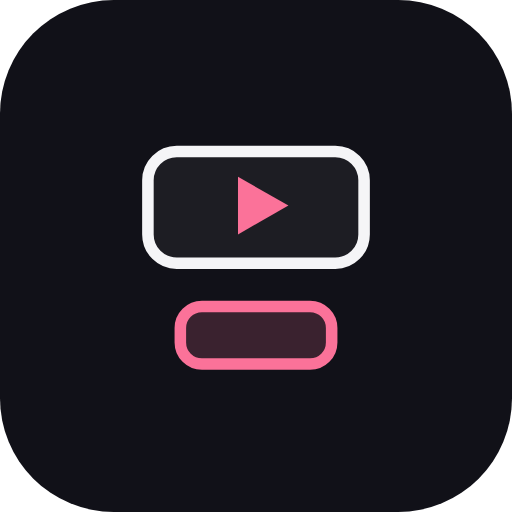
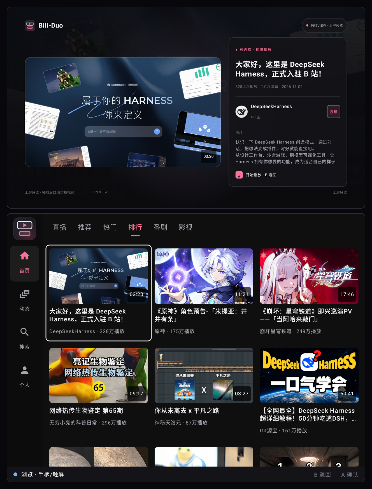
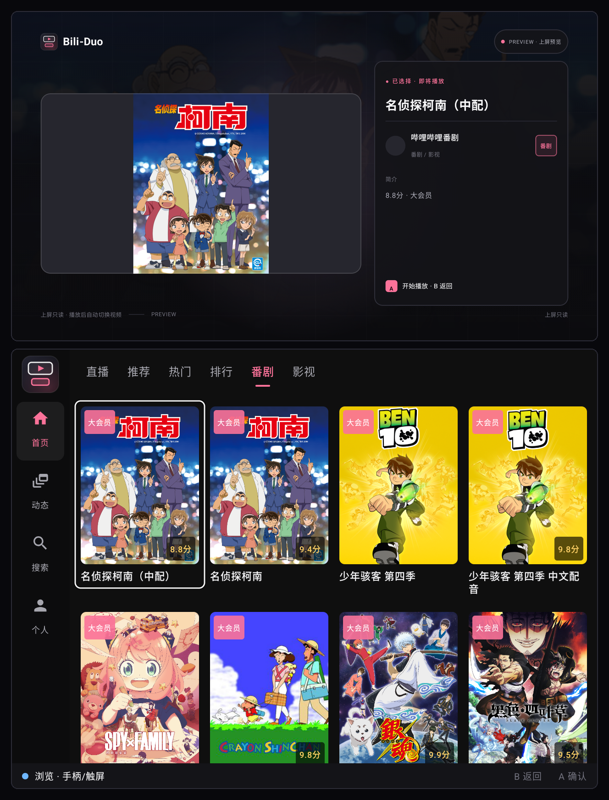
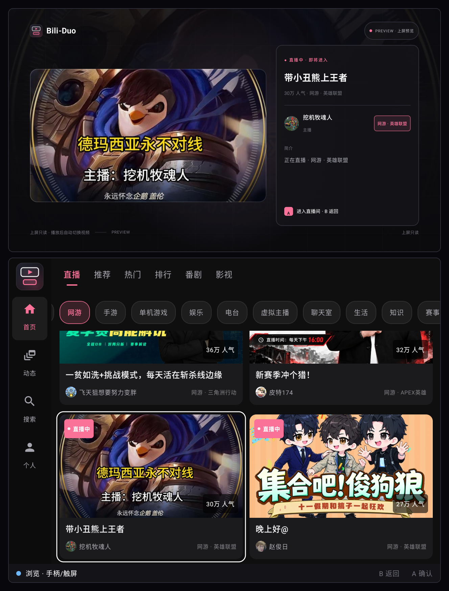
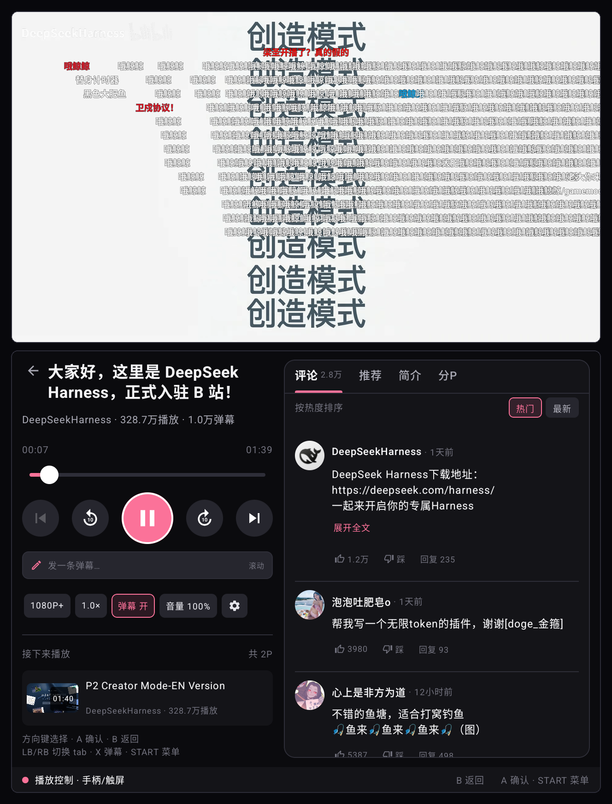
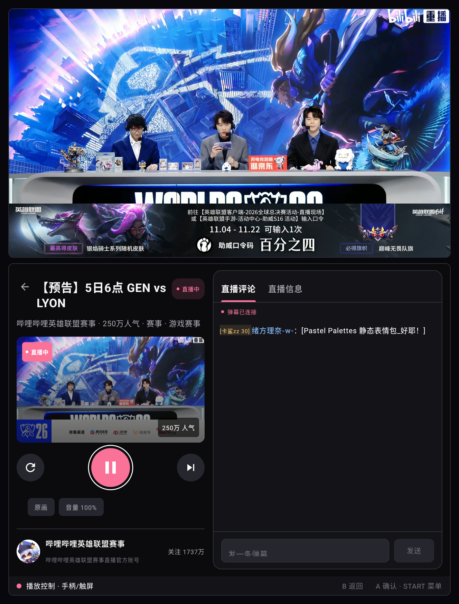

<p align="center">
  
</p>

<h1 align="center">Bili-Duo</h1>

<p align="center">
  <strong>双屏 B 站客户端</strong><br>
  为 Retroid Pocket Duo、AYN Thor 这类上下双屏 Android 掌机设计
</p>

<p align="center">
  
  
  
  
  
  
  
  
</p>

上屏只负责视频画面，下屏用一块 `Presentation` 承载完整 UI；手柄和触摸共用同一棵
Compose 焦点树，没有「现在在控上屏还是下屏」的模式切换，也没有上屏 OSD。

> 当前版本：**0.2.0-rc4**（versionCode 5）  
> 状态：功能完整的 **未测试 RC**，210 个单元测试通过，已在 MuMu 与 Duo 真机做核心
> 路径验证，尚未完成全流程回归。

## 界面预览

每张图为上下屏对照：上方是 1920×1080 上屏，下方是 1280×960 下屏。

| 首页 · 排行（焦点预览） | 番剧 / 影视（PGC） |
| --- | --- |
|  |  |
| **直播列表（下滚收起二级行）** | **视频播放 · 弹幕 + 控制台** |
|  |  |
| **直播播放 · 实时弹幕 / SC** | |
|  | |

截图使用公开推荐 / 直播流，不包含账号资料。

---

## 特性

### 双屏与输入

- **上屏只读**：唯一的 `PlayerView(useController=false)`，没有控制条、按钮或可聚焦
  控件；无视频时显示待机 / 预览 / 人物卡 / 设置面板 / 登录引导等只读场景。
- **下屏完整 UI**：首页、搜索、播放控制台、评论、动态、直播、个人中心、设置都在
  下屏 `Presentation` 中；`canHostTasks=false` 的设备也能正常显示。
- **单焦点模型**：`BROWSE / PLAYER / OVERLAY` 三种状态，不再有
  `TOP_PLAYER ↔ BOTTOM_UI` 双模式和 Y 键切换。
- **键位**：D-pad 移动焦点，A 确认，B 逐级返回，X 弹幕开关，START 清晰度菜单，
  LB/RB 切换右栏 tab；Y 不绑定。进度条可聚焦，左右键 ±10s。
- **肩键快捷键**：L1/R1 切一级 tab，L2/R2 切二级筛选行；长按只走一格。
- **overlay 独占**：清晰度、倍速、弹幕设置、发送、图片查看等打开时独占输入，
  B 只关闭 overlay，不退出播放。

### 内容

- **首页**：直播 / 推荐 / 热门 / 排行 / 番剧 / 影视六个 tab；推荐、热门、排行、
  PGC 列表，热门支持分页。
- **搜索**：搜索建议（250ms 防抖）、历史记录、热门搜索、五种排序、分页与重试；
  搜索框支持下屏系统 IME。
- **播放**：DASH 多清晰度、倍速、音量、进度 seek、分P/选集、相关推荐、UP 主空间
  入口；PGC 番剧/影视复用同一控制台。
- **评论**：分页、热门/最新排序、楼中楼回复分页、评论/回复点赞与点踩、长评论
  展开、评论图片缩略图与全屏查看器。
- **弹幕**：按 cid 拉取 XML（手动解 raw deflate）、上屏 Canvas 渲染、滚动/顶部/
  底部泳道、暂停冻结、seek 重建；下屏开关、透明度/速度/字号/显示区域、屏蔽词、
  同屏上限；普通视频支持发送与撤回。
- **字幕**：多字幕轨选择、开关、上屏只读字幕层；偏好持久化。
- **直播**：分区 chips（一级 + 子分区）、关注主播行、双列房间、HLS 播放、
  双栏控制台、实时弹幕/SC、清晰度/音量、直播信息；网格下滚时收起二级筛选行。
- **动态**：关注动态流、全部/视频/图文筛选、UP 主筛选、视频直达播放、图文详情/
  画册/纯文字阅读，上屏同步只读场景。
- **账号**：扫码 / 短信 / 密码三 tab 登录，二维码倒计时、A 刷新、极验 WebView；
  个人中心、历史、收藏、关注、下载、设置等二级页均为深色手柄 UI。
- **UP 主空间**：视频/合集切换、搜索、关注/取关确认、上屏预览。

### 播放与数据

- 单一活动级 `PlayerController` / `PlayerViewModel`，上下屏共享同一播放器状态。
- 进度上报按账号隔离；支持 debug 参数 `disable_progress_report` 在测试时关闭上报。
- 登录 Cookie 仅保存在本机 SharedPreferences；OkHttp 日志为 `BASIC` 且
  `redactHeader(Cookie/Set-Cookie/Authorization)`，不打印 token、验证码或响应 body。
- Release 构建启用 R8；Retrofit suspend 泛型的 keep 规则见
  [`app/proguard-rules.pro`](app/proguard-rules.pro)。

### 技术栈

| 层 | 选型 |
| --- | --- |
| 语言 | **Kotlin 1.9.23**（主体，`app/src` 约 3.7 万行，含测试）；XML 资源；设计原型用少量 HTML/CSS/JS |
| UI | Jetpack Compose + Material3、Navigation Compose |
| 播放 | Media3 / ExoPlayer 1.4.1（DASH、HLS）、OkHttp DataSource |
| 网络 | Retrofit 2.9 + Gson、OkHttp 4.12、WebSocket（直播弹幕/SC） |
| 图片 | Coil 2.6（含 GIF）、telephoto-zoomable |
| 登录 | ZXing 二维码、极验 Geetest WebView |
| 构建 | Gradle 8.7、AGP 8.4.0、JDK 17、R8 |
| 测试 | JUnit4，210 个单元测试 |
| 架构 | Activity + Presentation、MVVM + StateFlow、单一 `PlayerController` |
| 界面语言 | 简体中文（当前未做多语言资源） |

---

## 当前状态

### 已验证

- **单元测试**：210 个用例通过（`./gradlew testDebugUnitTest`）。
- **MuMu（1280×960 / 320dpi）**：双屏壳层、首页、搜索、播放控制台、直播列表与
  HLS 播放、动态空态/登录态、单屏回退提示、rc4 签名包安装与冷启动。
- **Retroid Pocket Duo 真机**：
  - 双屏冷启动、上屏视频、下屏触摸与系统 IME、后台恢复。
  - 视频：初始聚焦播放键、A 暂停、进度 ±10s/seek、X 弹幕、START 清晰度、
    B 从右栏回播放键、再 B 退出。
  - 直播：初始聚焦、LB/RB 切 tab、输入框 B 收键盘、B 层级退出、触摸直点。
  - 首页 L1/R1 切 tab、直播 L2/R2 切分区、动态 L1/R1 切筛选、L2/R2 切 UP 主。
  - 直播子分区 + 关注主播行下滚自动收起、回到顶部展开。
  - 评论图片全屏、弹幕开关/设置、字幕开关、PGC 切集、UP 主空间。
  - 登录、个人中心、历史/收藏/关注只读浏览；弹幕发送→撤回闭环。

### 未完成 / 待验证

- **直播真实发送与关注**：UI、校验和 API 已接，但未在公开直播间留下测试消息；
  需要明确授权后在无人直播间补测。
- **PGC VIP 集**：需要大会员账号验证播放/提示路径。
- **动态写操作**：发布、转发、点赞未实现，当前只读。
- **单屏回退**：目标设备始终双屏；无下屏时 VOD 走旧 `PlayerScreen`，直播/PGC
  显示「此内容需要下屏控制台」提示，不进入播放。
- **完整真机回归**：真实手柄长按 repeat、断连/热插拔、锁屏/休眠唤醒、
  120Hz/HDR、弱网/断网矩阵尚未系统覆盖。
- **部分登录态路径**：云端观看进度同步、PGC VIP、收藏/关注真实卡片预览待补测。
- **UP 主空间 / 搜索肩键**：代码已接同一套 `duoTabCycling`，尚未单独做真机点验。

### 已知限制

- 本项目是非官方客户端，B 站 API 可能随时变更；接口失效时部分页面会不可用。
- 目标设备为上下双屏掌机，UI 按 **640×480dp 下屏 + 1920×1080 上屏** 设计，
  普通单屏手机不是验收目标。
- 直播清晰度/线路由服务端返回决定；VIP/付费内容受账号权限限制。
- 未实现动态发布、直播关注按钮、完整二级分区树等长尾功能。

---

## 键位

### 浏览页（`BROWSE`）

| 输入 | 行为 |
| --- | --- |
| D-pad | 移动焦点 / 列表滚动 |
| A | 确认、播放、打开 |
| B | 关闭页内确认层 → 返回上一页 |
| X | 页面上下文操作 |
| Y | 搜索页切排序；其他页面无绑定 |
| L1 / R1 | 切一级 tab（首页、动态、UP 主空间） |
| L2 / R2 | 切二级筛选（直播分区、动态 UP 主、搜索排序） |
| START | 页面菜单（如有） |

### 视频 / 直播控制台（`PLAYER`）

| 输入 | 行为 |
| --- | --- |
| D-pad | 移动焦点；视频进度条聚焦时左右 seek 10s |
| A | 激活焦点：播放/暂停、±10s、清晰度、倍速、弹幕、字幕、音量、tab、评论操作 |
| B | 关 overlay → 右栏回播放键 → 左栏根退出 |
| X | 弹幕开/关（直播不绑定） |
| START / MENU | 打开清晰度菜单 |
| LB / RB | 切换右栏 tab（评论/推荐/简介/分P；直播评论/信息） |
| Y | 不绑定 |
| 触摸 | 一次点击直接操作 |

### Overlay

D-pad 选择，A 确认，B 关闭并回到触发控件；Y 不绑定，不允许越过 overlay 切模式。

---

## 架构

```
MainActivity（上屏 Activity）
├── PlayerView(useController = false)     // 只渲染视频
├── TopScreenHost                         // 只读待机/预览/人物/设置场景
├── PlayerController                      // 唯一 ExoPlayer
├── DuoSessionViewModel                   // 模式、overlay、B 拦截器
└── InputRouter                           // 手柄事件 → 下屏焦点树
        │
        ▼
SecondScreenPresentation（下屏）
└── ComposeView → DuoApp
    ├── NavHost / 页面
    ├── DuoFocus（焦点环、duoClickable、duoTabCycling）
    └── Overlay / ModeBar
```

- 上屏 Activity 与下屏 `Presentation` 共享同一个 Activity-scoped ViewModel 和
  `PlayerController`；播放器状态只有一份。
- 下屏 `Presentation` 自己提供 Lifecycle / ViewModelStore / SavedStateRegistry。
- 输入只有一棵焦点树：`InputRouter` 把 A 翻译为 `DPAD_CENTER`，B 走
  `requestBack()`，其余键转发给下屏 `decorView`。
- B 的优先级：页面级 `setBackInterceptor` → 播放器右栏 `setFocusBackInterceptor`
  → `NavHost.popBackStack()`。

详细设计见 [`docs/ARCHITECTURE.md`](docs/ARCHITECTURE.md) 和
[`docs/ui/INPUT_AND_FOCUS.md`](docs/ui/INPUT_AND_FOCUS.md)。

---

## 构建

### 环境

- JDK 17
- Android SDK（compileSdk / targetSdk 34，minSdk 24）
- Gradle Wrapper 8.7（随仓库提供）
- AGP 8.4.0、Kotlin 1.9.23、Compose BOM 2024.04.01、Media3 1.4.1

### 命令

```bash
export JAVA_HOME=/path/to/jdk17
export ANDROID_HOME=/path/to/android-sdk
export ANDROID_SDK_ROOT="$ANDROID_HOME"

./gradlew assembleDebug
./gradlew testDebugUnitTest
./gradlew assembleRelease
```

Windows 下项目路径含非 ASCII 字符时，`gradle.properties` 已设置
`android.overridePathCheck=true`，不要删除。

### 签名

Release 签名从仓库外的 `keystore.properties` 读取（模板见
[`keystore.properties.example`](keystore.properties.example)）：

```properties
storeFile=keystore/bili-duo-release.jks
storePassword=CHANGE_ME
keyAlias=biliduo
keyPassword=CHANGE_ME
```

**真实 keystore、口令和 `keystore.properties` 永远不会提交到仓库。** 丢失 keystore
后无法覆盖升级已安装的 release 包，请自行备份。

### 测试产物

`dist/` 只保留构建说明；APK 通过 GitHub Releases 或本地构建分发，不进入 Git 历史。
当前 rc4 的哈希与说明见 [`dist/README.md`](dist/README.md)。

---

## 项目结构

```
app/src/main/java/cn/xfangfang/biliduo/
├── MainActivity.kt              // 上屏宿主 + 共享 VM/Controller
├── duo/                         // Presentation 壳层、输入会话、事件桥
├── data/                        // API、模型、仓库
├── ui/
│   ├── navigation/              // Screen / Routes / NavHost
│   ├── duo/                     // 焦点环、duoClickable、肩键循环
│   ├── home/                    // 直播/推荐/热门/排行/番剧/影视
│   ├── search/                  // 搜索、建议、历史、热门、排序
│   ├── player/                  // 控制台、PlayerController、弹幕、字幕
│   ├── live/                    // 直播控制台、HLS、实时弹幕/SC
│   ├── dynamic/                 // 动态流、详情、画册、文字阅读
│   ├── top/                     // 上屏只读场景 + 弹幕/字幕层
│   ├── channel/                 // UP 主空间
│   ├── profile/ login/          // 个人中心、扫码/短信/密码登录
│   └── history/ favorites/ following/ downloads/ settings/
└── ...

docs/
├── ARCHITECTURE.md              // 双屏架构与数据流
├── bili-duo-research.md         // 技术选型与参考项目
├── ui/                          // 设计系统、页面规格、输入规范、上屏规范
├── research/                    // UI/交互调研
└── images/                      // README 截图（匿名公开数据）
```

---

## 设计与开发文档

- [docs/ARCHITECTURE.md](docs/ARCHITECTURE.md) — 双屏架构、PlayerController、InputRouter
- [docs/ui/INPUT_AND_FOCUS.md](docs/ui/INPUT_AND_FOCUS.md) — 单焦点键位、B 层级、焦点环
- [docs/ui/DESIGN_SYSTEM.md](docs/ui/DESIGN_SYSTEM.md) — 色彩、字体、间距、组件、动效
- [docs/ui/SCREEN_SPEC.md](docs/ui/SCREEN_SPEC.md) — 下屏页面线框与尺寸
- [docs/ui/TOP_SCREEN.md](docs/ui/TOP_SCREEN.md) — 上屏视频/只读场景规范
- [docs/bili-duo-research.md](docs/bili-duo-research.md) — 选型、竞品与双屏限制
- [docs/research/2026-11-03-ui-research.md](docs/research/2026-11-03-ui-research.md) — UI 调研
- [docs/ui/mockups/](docs/ui/mockups/) — 1280×960 视觉原型
- [docs/ui/prototype/](docs/ui/prototype/) — 早期可点击交互原型（键盘模拟手柄）

> `mockups/` 和 `prototype/` 保留了早期的 Y 模式切换设计；该设计已废弃，
> 当前键位以 [`docs/ui/INPUT_AND_FOCUS.md`](docs/ui/INPUT_AND_FOCUS.md) 为准。
> 设计稿与实现可能有细微差异，以本文「当前状态」和实际代码为准。

---

## 参考项目与致谢

本项目从 [bilibili-pure-apk](https://github.com/yearzen1/bilibili-pure-apk)（MIT）
起步，保留其 B 站 API、登录、DASH 播放、评论、历史、收藏、字幕和下载能力。

双屏 / 焦点设计参考了以下项目（仅作研究与交互参考，未包含其代码）：

- [wiliwili](https://github.com/xfangfang/wiliwili) — C++/borealis 的主机风格播放器
- [bilimiao2](https://github.com/10miaomiao/bilimiao2) — 功能完整的第三方 B 站客户端
- [BBLL](https://github.com/xiaye13579/BBLL) — TV/遥控器优先的交互
- [xVideoPlayer](https://github.com/MaiconErick/xVideoPlayer) — 上屏视频 + 下屏 Presentation
- [EmuLnk](https://github.com/EmuLnk/emulnk) — 双屏掌机的 companion dashboard
- [Wayfinder](https://github.com/Thor-Wayfinder/thor-wayfinder) — Android 双屏焦点限制

技术栈：Jetpack Compose、Media3/ExoPlayer、Retrofit + OkHttp、Coil、ZXing、
telephoto-zoomable、Gson；直播实时弹幕使用 WebSocket + zlib。

> 参考项目各自的许可证独立于本项目。`bilimiao2`、`wiliwili` 为 GPL-3.0，
> 本项目**未复制其代码**；如未来移植，需要重新评估整体许可证策略。

---

## 隐私与声明

- 本项目是**非官方**第三方客户端，与哔哩哔哩无关联。
- 登录 Cookie、`SESSDATA`、`refreshToken` 只保存在本机；仓库、日志和截图不包含
  任何账号凭证。调试日志不打印 Cookie、手机号、验证码或响应 body。
- 仓库不包含 release keystore、`keystore.properties`、本地 SDK 路径、设备序列号
  或真实账号数据。
- 使用第三方客户端存在账号风险；请自行评估并遵守 B 站用户协议。因使用本项目
  产生的任何后果由使用者自行承担。

## License

MIT。基座版权归 `yearzen1` 所有，详见 [LICENSE](LICENSE) 与 [NOTICE](NOTICE)。
